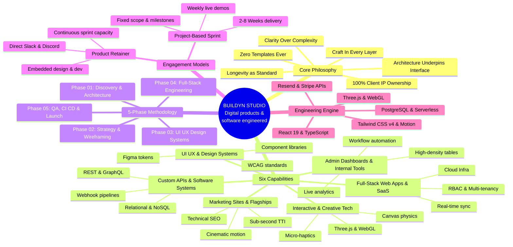
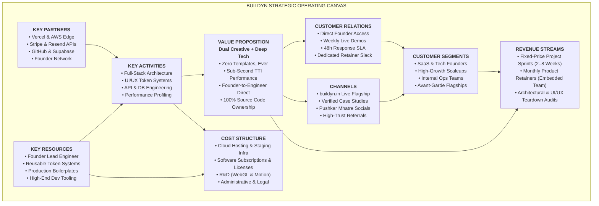

# Buildyn — Visual Asset Design Specifications (`design.md`)

This document outlines the visual architecture, content hierarchy, layout schematics, typography, color tokens, and generation prompts for two core brand visual assets:
1. **Asset 01: Buildyn Studio Mindmap (Ecosystem & Architecture)**
2. **Asset 02: Buildyn Business Model Canvas (Strategic Operating Engine)**

---

## Brand Aesthetic Foundation & Design Tokens

Both visual assets must adhere to Buildyn's dark editorial brutalism and tactile luxury tech visual language.

### Color Palette
| Token | Hex Code | Role | Description |
|---|---|---|---|
| **Void / Paper** | `#0a0606` | Primary Canvas | Ultra-deep warm charcoal/black background |
| **Surface / Card** | `#120e0e` / `#161111` | Node Containers | High-end card surfaces with subtle depth |
| **Ink / Off-White** | `#f4efe6` | Primary Headings | Warm, editorial high-contrast text |
| **Ink Muted** | `#a39d94` | Body Copy & Meta | Soft technical gray-sand for descriptions |
| **Crimson Accent** | `#c0382b` | Primary Accent | Buildyn signature red for nodes, badges & connectors |
| **Crimson Glow** | `rgba(192, 56, 43, 0.18)` | Ambient Atmosphere | Radial background glow and focus highlights |
| **Border Soft** | `rgba(244, 239, 230, 0.08)` | Dividers & Grids | Subtle structural dividers and connector paths |
| **Border Active** | `rgba(192, 56, 43, 0.40)` | Highlights & Focus | Active border highlights and key branches |

### Typography Guidelines
- **Display / Headers**: *Cabinet Grotesk* or *Syne* / *Satoshi* (Bold / Medium, tracked tight `-0.03em`)
- **Editorial Emphasis**: *Instrument Serif* or *Editorial New* (Italic, used selectively for signature words like *"engineered"*, *"longevity"*, *"craft"*)
- **Body & Meta**: *General Sans* or *Inter* (Regular / Medium, clean readability)
- **Technical & Tags**: *JetBrains Mono* or *Space Mono* (Monospace for IDs e.g., `01 //`, `PHASE 03`, `TTI < 1s`)

### Visual Texture & Atmosphere
- Background features a subtle 24px isometric or rectangular grid at 4% opacity.
- Soft grain/film texture overlay (3% opacity) for tactile depth.
- Glassmorphic card backdrops with `backdrop-filter: blur(16px)` and 1px crisp borders.
- Glowing connecting lines with directional arrows and micro-dots at intersection nodes.

---

# Asset 01: Buildyn Studio Ecosystem Mindmap

### Purpose & Context
Visualizes the interconnected universe of Buildyn — from core philosophy and 6 capability vectors to the 5-phase engineering methodology, engagement models, and modern technology stack.

### Canvas Specifications
- **Aspect Ratio**: 16:9 Landscape (recommended: `3840 × 2160 px` for 4K Presentation, or `1920 × 1080 px`)
- **Layout Structure**: **Radial Hub & Spoke System** with a prominent central core and 5 primary radial branch clusters.

---

### Mindmap Node Hierarchy & Content

```
                                  [01. CORE PHILOSOPHY & PILLARS]
                                                ▲
                                                │
[05. TECH STACK & ENGINE] ◄─── ● BUILDYN CENTRAL CORE ● ───► [02. SIX CAPABILITY VECTORS]
                                                │
                                                ▼
                     [04. ENGAGEMENT MODELS] ───┴─── [03. 5-PHASE METHODOLOGY]
```

#### Center Hub (Core Identity)
- **Label**: **BUILDYN**
- **Tagline**: *"Digital products and software engineered."*
- **Manifesto**: *"Robust architecture, tactile UX, and enduring products built to perform."*
- **Meta Badge**: `EST. 2026 // STUDIO CORE`
- **Visual Style**: Glowing circular or rounded octagon badge in `#161111` with Crimson ring border (`#c0382b`) and ambient glow.

---

#### Radial Branch 01: Core Operating Pillars (Top / North)
*Focus: Foundational beliefs that dictate code and design quality.*
- **Sub-Node 1.1**: `01 // Architecture Underpins Interface`
  - Solid data models, scalable backend pipelines, and zero-compromise UX cohesion.
- **Sub-Node 1.2**: `02 // Clarity Over Complexity`
  - Ergonomic speeds, cognitive ease, high-density clarity without visual clutter.
- **Sub-Node 1.3**: `03 // Craft in Every Layer of Code`
  - Rejection of sloppy shortcuts, strict TypeScript typing, pixel-accurate micro-interactions.
- **Sub-Node 1.4**: `04 // Longevity as Engineering Standard`
  - Modular component systems, resilient infrastructure, future-proof scalability.
- **Sub-Node 1.5**: `05 // Studio Operating Rules`
  - Zero templates ever • 100% IP & source code ownership • Founder-to-engineer direct.

---

#### Radial Branch 02: 6 Capability Vectors (Right / East)
*Focus: What Buildyn constructs for founders and high-growth brands.*
- **Sub-Node 2.1**: `01 // Full-Stack Web Apps & SaaS`
  - End-to-end multi-tenant systems, real-time data sync, RBAC, billing, cloud infrastructure.
- **Sub-Node 2.2**: `02 // Admin Dashboards & Internal Software`
  - High-density data tables, advanced filtering, metrics visualization, custom workflow panels.
- **Sub-Node 2.3**: `03 // Marketing Websites & Digital Flagships`
  - High-converting landing funnels, cinematic motion, technical SEO, sub-second TTI.
- **Sub-Node 2.4**: `04 // UI/UX & Design Systems`
  - Figma token libraries, atomic component architectures, WCAG accessibility, user journey maps.
- **Sub-Node 2.5**: `05 // Custom Software Systems & APIs`
  - REST & GraphQL APIs, relational & document modeling, webhook pipelines, security hardening.
- **Sub-Node 2.6**: `06 // Interactive Experiences & Creative Tech`
  - WebGL shaders, Three.js 3D scenes, physics-based canvas motion, dynamic audio-visuals.

---

#### Radial Branch 03: 5-Phase Engineering Lifecycle (Bottom-Right / South-East)
*Focus: The linear progression from ideation to production launch.*
- **Phase 01**: `Discovery & System Architecture`
  - Feature scoping, roadmap definition, data schema architecture, tech stack selection.
- **Phase 02**: `Strategy, User Flows & Wireframes`
  - Information architecture, low-fidelity wireframing, state machine diagrams, conversion funnels.
- **Phase 03**: `UI/UX & Design Systems`
  - High-fidelity Figma tokens, interactive prototypes, micro-interaction calibration.
- **Phase 04**: `Full-Stack Engineering & APIs`
  - TypeScript frontend & backend, database integrations, auth, state sync, security testing.
- **Phase 05**: `Deployment, Testing & Production Launch`
  - Cross-device QA, edge-case audit, CI/CD pipeline automation, zero-downtime deployment.

---

#### Radial Branch 04: Commercial Engagement Models (Bottom-Left / South-West)
*Focus: How clients partner with Buildyn.*
- **Model A**: `Project-Based Sprint`
  - Fixed scope & architectural milestones
  - 2 to 8 weeks delivery velocity
  - Weekly live working demos
  - Complete handover of Figma tokens, DB schemas & Git repositories
- **Model B**: `Product Retainer`
  - Embedded design & software engineering team
  - Dedicated weekly sprint capacity
  - Direct Slack/Discord channel access
  - Continuous feature rollout & strategic iterations

---

#### Radial Branch 05: Platform Tech Stack & Engine (Left / West)
*Focus: The engineering toolkit powering every system.*
- **Frontend & Core**: React 19, Next.js, Vite, TypeScript
- **Styling & Motion**: Tailwind CSS v4, Framer Motion, GSAP, Lenis Smooth Scroll
- **3D & Creative Tech**: Three.js, WebGL Shaders, Canvas API
- **Backend & Data**: Node.js, Vercel Serverless, PostgreSQL, MySQL, MongoDB, Stripe Pipelines
- **Communications & DevOps**: Resend API, GitHub CI/CD, Edge Networks

---

### Mermaid Diagram Code (Mindmap)



---

# Asset 02: Buildyn Business Model Canvas & Strategic Engine

### Purpose & Context
Presents Buildyn's commercial blueprint, strategic positioning, customer segments, value engines, and revenue mechanisms in an executive-grade Bento-Grid Canvas.

### Canvas Specifications
- **Aspect Ratio**: 16:9 Landscape (`3840 × 2160 px` or `1920 × 1080 px`)
- **Layout Structure**: Modern **Bento Grid / 9-Box Strategy Matrix** optimized for high-density readability and boardroom clarity.

---

### Strategy Matrix Structure (9 Strategic Blocks)

| 1. Key Partners | 2. Key Activities & Engineering | 3. Value Proposition (Core) | 4. Customer Relationships | 5. Customer Segments |
|---|---|---|---|---|
| Cloud & Infra, Payment APIs, Founder Network | Full-Stack Dev, UI/UX Architecture, Systems Design | **Dual Craft**: High-End Design + Deep Engineering with 100% Code Ownership | Founder-to-Engineer Direct, Weekly Demos, Retainer Slack | Tech Startups, SaaS Founders, High-Growth Scaleups |
| **6. Key Resources** | | | **7. Channels** | |
| Proprietary Component Token Libs, Direct Founder Talent | | | Inbound Organic Flagship, Founder Twitter/LinkedIn, Portfolio Case Studies | |
| **8. Cost Structure** | | | **9. Revenue Streams** | |
| High-Performance Workstations, Cloud Sandbox Infrastructure, Design Tools | | | Fixed-Price Sprint Contracts ($/₹), Monthly High-Tier Product Retainers | |

---

### Detailed Box-by-Box Content Blueprint

#### Box 01: Value Propositions (The Central Differentiator)
*Heading*: **WHAT MAKES BUILDYN UNBEATABLE**
- **Bridge Creative & Deep Tech**: Eliminates the disconnect between design agencies (who can't write code) and dev shops (who compromise on aesthetics).
- **Zero Templates / Bespoke Architecture**: Every system engineered from scratch for performance, scalability, and brand dominance.
- **Sub-Second Performance & Tactile Polish**: 100/100 Lighthouse scores, cinematic micro-interactions, responsive ergonomics.
- **Founder-to-Engineer Direct Access**: No account managers, telephone games, or outsourced junior teams.
- **100% Client Ownership**: Complete handover of Figma design tokens, databases, and clean Git repository code.

---

#### Box 02: Customer Segments (Target ICP)
*Heading*: **WHO WE BUILD FOR**
- **SaaS & Tech Founders**: Seed to Series B startups requiring production-grade MVPs or total platform re-architectures.
- **Internal Operations & Scaleups**: Companies with complex internal workflows requiring high-density admin dashboards and automation software.
- **Pioneering Digital Brands**: Avant-garde fashion, architecture, spatial design, and creative agencies needing flagship marketing platforms (e.g., *WispEcho*, *Sonder Cafe*, *Sienvera*).
- **Non-Technical Visionary Leaders**: Founders seeking a turnkey product partner to translate product visions into scalable codebases.

---

#### Box 03: Customer Relationships (The Partnership Experience)
*Heading*: **HOW WE COLLABORATE**
- **Founder-to-Founder Communication**: Direct collaboration with Pushkar Mhatre (Founder & Lead Developer).
- **Weekly Live Working Demos**: No surprise reveal at the end — clients test live staging deployments weekly.
- **Real-Time Synergy**: Dedicated Slack/Discord channels for retainer partners.
- **48-Hour Response SLA**: Transparent, rapid communication across all project phases.

---

#### Box 04: Distribution & Acquisition Channels
*Heading*: **HOW CLIENTS DISCOVER BUILDYN**
- **Living Flagship Showcase**: High-impact studio website (`buildyn.in`) demonstrating live WebGL and performance benchmarks.
- **Proof-of-Work Portfolio**: Verifiable live client deployments (*WispEcho*, *Sonder Cafe*, *Sienvera*).
- **Founder Social Ecosystem**: Pushkar Mhatre's engineering writeups on LinkedIn, GitHub repos, and X/Twitter.
- **High-Trust Referrals**: Inbound referrals from satisfied founders and venture networks.

---

#### Box 05: Key Activities & Core Workflows
*Heading*: **WHAT BUILDYN EXECUTES DAILY**
- **System Architecture & Data Modeling**: Designing resilient schemas, API routes, and cloud environments.
- **UI/UX & Component Systems**: Architecting ergonomic interfaces and tokenized Figma components.
- **Full-Stack Implementation**: Writing clean, type-safe React 19, Next.js, and Node.js code.
- **Performance & Security Hardening**: Optimizing core web vitals, WCAG standards, and OWASP security practices.

---

#### Box 06: Key Resources & Proprietary Assets
*Heading*: **WHAT DRIVES OUR EFFICIENCY**
- **Core Engineering Talent**: Pushkar Mhatre — Lead Developer & Systems Architect.
- **Proprietary Design Token Library**: Modular design systems that accelerate delivery without using templates.
- **Production Boilerplates & Utilities**: Battle-tested authentication, payment, and database integrations.
- **Modern Hardware & Creative Tooling**: 4K calibrated displays, Three.js shaders, and local AI development environments.

---

#### Box 07: Key Partners & Ecosystem
*Heading*: **STRATEGIC DEPENDENCIES**
- **Cloud & Hosting Platforms**: Vercel (Edge, Serverless Functions), AWS, Cloudflare.
- **Database & Data Layer**: Supabase, PostgreSQL, MongoDB Atlas, Prisma ORM.
- **Developer & Third-Party APIs**: Stripe (payments), Resend (transactional email pipelines), GitHub.
- **Design & Prototype Tooling**: Figma, Framer, Blender, GSAP.

---

#### Box 08: Cost Structure (Lean & High-Margin)
*Heading*: **WHERE CAPITAL IS ALLOCATED**
- **Infrastructure & Cloud Testing**: Vercel Pro, staging environments, domain assets, database instances.
- **Developer Tooling & Software Licenses**: Figma Professional, GitHub Enterprise, specialized UI/UX libraries.
- **Continuous R&D**: Prototyping creative tech, WebGL shaders, Three.js performance profiling.
- **Legal & Administrative**: Intellectual property assignment, client contracts, compliance.

---

#### Box 09: Revenue Streams & Monetization Engine
*Heading*: **HOW BUILDYN GENERATES CAPITAL**
- **Revenue Model 01: Project-Based Sprints**
  - Scope: End-to-end design & development of MVPs, platforms, or flagships.
  - Structure: Fixed-price milestone contracts (typically 3–8 weeks sprint duration).
  - Payment Terms: 50% upfront deposit / 25% architecture & design milestone / 25% pre-launch sign-off.
- **Revenue Model 02: Dedicated Product Retainers**
  - Scope: Embedded product partner for continuous feature rollout, scaling, and architectural maintenance.
  - Structure: High-ticket recurring monthly subscription (dedicated weekly engineering hours).
- **Revenue Model 03: Advisory & Architectural Audits**
  - Scope: 1-to-2 week technical audits, code refactoring roadmaps, and UI/UX ergonomic teardowns.

---

### Mermaid Diagram Code (Business Model Canvas Bento Grid)



---

# AI Image Generation Prompts

If you are generating these visuals using AI models (such as **Midjourney v6**, **Flux 1.1 Pro**, or **DALL-E 3**), use the following prompt formulas crafted specifically for Buildyn's aesthetic:

### Prompt 01: Mindmap Visual
```text
A futuristic, ultra-clean isometric infographic mindmap diagram for "BUILDYN - Software Engineering Studio", dark mode aesthetic, deep obsidian background #0a0606 with glowing crimson red #c0382b circuit lines and connecting nodes. In the center, a luminous circular core hub labeled "BUILDYN". Radiating outward into five elegant floating glassmorphic Bento cards: "Core Philosophy", "6 Capabilities", "5-Phase Methodology", "Engagement Models", and "Tech Stack". Modern typography with subtle monospaced technical codes, sharp 1px borders, subtle radial crimson glow, luxury tech brutalism, clean data visualization, high resolution, 8k, UI/UX editorial design, Behance award-winning graphic --ar 16:9 --v 6.1 --style raw
```

### Prompt 02: Business Model Canvas Visual
```text
An executive dark-mode Business Model Canvas presented as an ultra-modern Bento Grid UI layout, sleek technical aesthetic. Deep matte black background #0a0606, translucent dark glass cards with razor-thin borders and crimson accent highlights #c0382b. 9 structured modular panels labeled: "Key Partners", "Key Activities", "Value Proposition", "Customer Relationships", "Customer Segments", "Key Resources", "Channels", "Cost Structure", "Revenue Streams". Inside cards, clean minimalistic icons, crisp typography, data metrics, and technical graphs. Minimalist luxury tech branding, Dieter Rams functionalism meets futuristic software terminal, octane render, 8k resolution --ar 16:9 --v 6.1 --style raw
```

---

# Figma / Manual Graphic Implementation Steps

For designers building these visuals in **Figma**, **Illustrator**, or **Canva**:

1. **Canvas Setup**:
   - Frame: `3840 × 2160 px` (4K 16:9).
   - Background Fill: Solid `#0a0606`.
   - Grid: Layout Grid with 12 Columns (Margin: `120px`, Gutter: `32px`) or Isometric Grid (Step: `32px`, Color: `#f4efe6`, Opacity: `3%`).

2. **Ambient Glow Layers**:
   - Create 2 large ellipses (`1200 × 1200 px`), Fill `#c0382b`, Layer Blur `350px`, Opacity `12%` placed at top-right and bottom-left to create depth.

3. **Card Styles (Bento Boxes & Nodes)**:
   - Fill: `#130f0f` with `80%` opacity + `Backdrop Blur: 20px`.
   - Stroke: Inside, `1px`, Solid `#f4efe6` with `8%` opacity (or `#c0382b` at `40%` for active/featured cards).
   - Corner Radius: `16px` for small nodes, `24px` for main containers.

4. **Connector Paths (Mindmap)**:
   - Stroke: `1.5px`, Dash: `4, 4` or Solid `#c0382b` with `30%` opacity.
   - Terminal Nodes: `6px` solid circle dots in `#c0382b`.

5. **Exporting Settings**:
   - Export 1x and 2x PNG (Color space: sRGB, non-interlaced) for web flagships and presentations.
   - Export SVG for infinitely scalable vector documentation.

